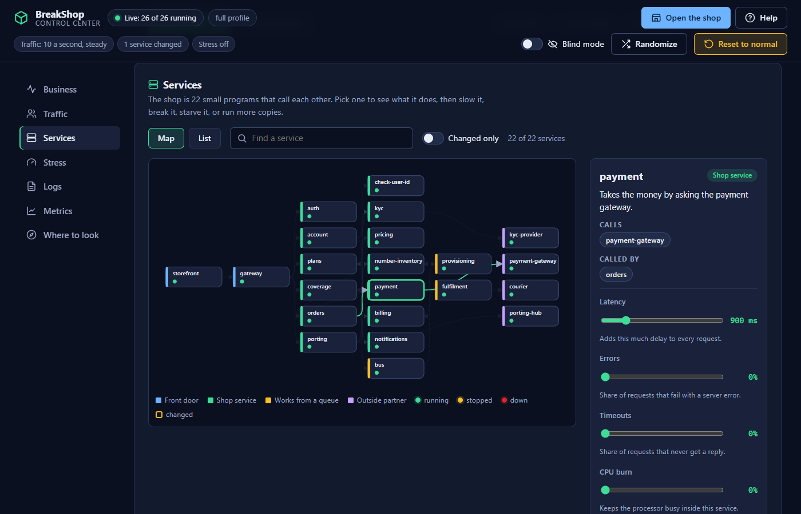
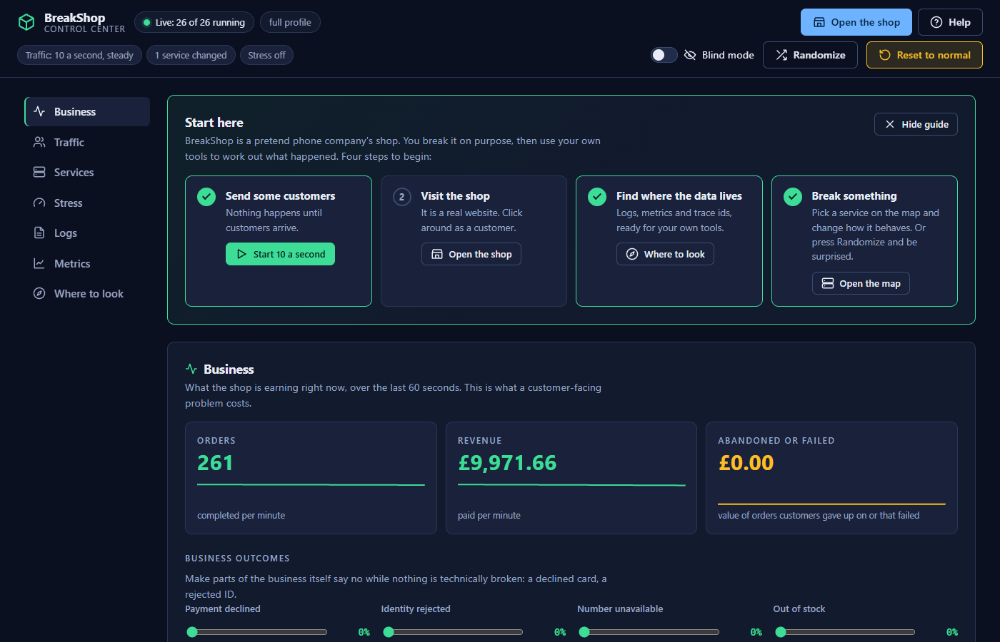
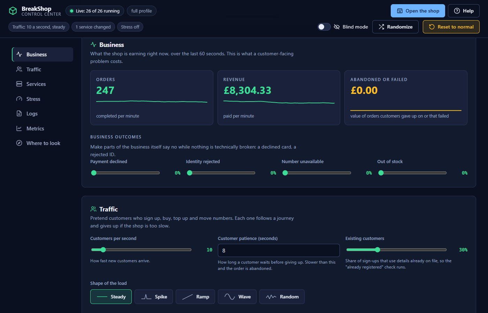
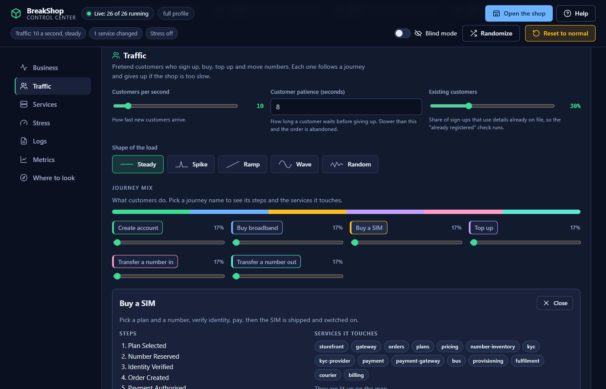
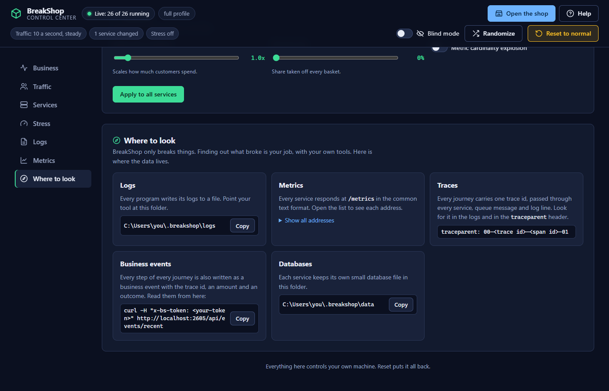
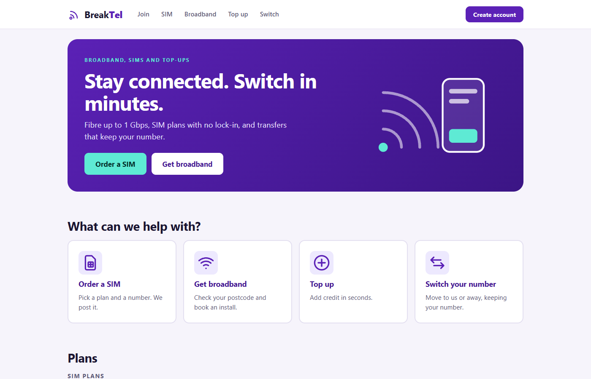

# BreakShop

**A telecom shop built to be broken.**

BreakShop is a small, realistic microservice application for practising observability. A fictional operator, BreakTel, sells broadband and SIM cards online. You run it on your own computer, make it slow, flaky and noisy from a control page, and then use whatever observability tool you like to work out what happened.

It is not tied to any vendor or course. It writes logs, exposes metrics, and carries one trace id through every request, so you can point Dynatrace, Datadog, New Relic, Grafana, Elastic, OpenTelemetry or plain `grep` at it.

There is deliberately no answer key. The Control Center shows what you have set right now, never a history of what was broken or why. Finding the cause is the exercise.



## Contents

- [Quick start](#quick-start)
- [Screenshots](#screenshots)
- [Connect your observability tool](#connect-your-observability-tool)
- [What you get](#what-you-get)
- [The shop](#the-shop)
- [The Control Center](#the-control-center)
- [Things to try](#things-to-try)
- [Where the data lives](#where-the-data-lives)
- [Tracing and business events](#tracing-and-business-events)
- [Architecture](#architecture)
- [Configuration](#configuration)
- [Control Center API](#control-center-api)
- [Containers (experimental)](#containers-experimental)
- [Tests](#tests)
- [Troubleshooting](#troubleshooting)
- [Licence](#licence)

## Quick start

You need **Node.js 22 or newer** and about **1.5 GB of free memory** for the full set.

1. Clone this repository.
2. Run the start script for your system:

```
./start.sh            # macOS and Linux
.\run.bat             # Windows (cmd or PowerShell)
```

The script uses the Node.js you already have. If it is missing or too old, the script asks before downloading a private copy that leaves your own Node.js alone. It then installs one dependency (`sqlite3`) and starts everything.

3. Open the Control Center at **http://localhost:2605**. The shop is at **http://localhost:5620**.
4. Stop everything with `./stop.sh` or `.\stop.bat`.

Short on memory? Start the lighter set: `./start.sh lite` or `.\run.bat lite`.

Run it every day, start and stop it as often as you like. Nothing is installed system-wide.

## Screenshots

**First visit.** A four-step guide explains what to do.



**Business.** Orders, revenue and lost value per minute. Here payment has been slowed to 900 ms and revenue is already feeling it.



**Journeys.** Pick a journey to see its steps and the services it touches, lit up on the map.



**Where to look.** Log folders, metrics addresses and a command for recent business events, ready to copy.



**The shop.** A real, clickable store for BreakTel.



## What you get

| Piece | Count | What it is |
|---|---|---|
| Shop services | 17 | Storefront, gateway, auth, account, check-user-id, kyc, plans, coverage, number-inventory, pricing, orders, payment, billing, provisioning, porting, fulfilment, notifications. Each is its own process with its own SQLite file. |
| Partners | 4 | Pretend outside companies: payment-gateway, kyc-provider, courier, porting-hub. |
| Message bus | 1 | A queue the order flow leaves messages on, so some work happens a moment later. |
| Scheduler | 1 | Background jobs. |
| Load generators | 2 | `loadgen-users` (customer traffic) and `loadgen-resources` (safe CPU and memory stress). |
| Control Center | 1 | The page where you change how everything behaves. |
| Supervisor | 1 | Starts, restarts and stops all of the above and keeps the service directory. |

The full set is 26 processes. The only dependency is `sqlite3`. All databases are in-house SQLite files, so there is nothing to install or log in to.

## The shop

BreakTel's website is a real, clickable store. Customers can:

- **Create an account.** If the person is already registered, the account service is told by `check-user-id` and the journey stops early.
- **Buy a SIM.** Pick a plan and a number, verify identity, pay, then the SIM is shipped and switched on.
- **Buy broadband.** Check the postcode, pay, then an install is booked and the line is switched on.
- **Top up.** Pay a small amount and have it added as credit.
- **Transfer a number in or out** of another operator.

Every purchase has a money value, so a slow or failing service has a visible business cost: orders per minute, revenue per minute, and the value of orders customers gave up on.

## The Control Center

Open http://localhost:2605. A four-step **Start here** guide walks a first-time user through sending customers, visiting the shop, finding the data, and breaking something. **Help** opens a plain-English glossary.

- **Business.** Orders, revenue, and the value of abandoned or failed orders, per minute, with a 60-second trend. Below that, *business outcomes*: make the business say no while nothing is technically broken (payment declined, identity rejected, number unavailable, out of stock).
- **Traffic.** Start or stop pretend customers. Choose customers per second, the load shape (steady, ramp, spike, wave, random), how patient customers are, the share who are already registered, and the mix of journeys. Click a journey name to see which services it touches.
- **Services.** A live map of the shop, with a list view as an alternative. Select a service to read what it does and which services it calls and is called by. Then change it:
  - Latency, errors, timeouts
  - CPU burn, memory leak
  - Slow database query
  - Failing dependencies
  - **Copies:** run several copies of a service (a pretend disaster-recovery setup) and stop or start individual copies. Business numbers stay steady while infrastructure numbers change.
- **Stress.** Raise CPU or memory on a chosen target. Limits are capped to stay safe for a laptop, and **Stop stress** appears only while stress is running.
- **Logs.** Change the log format (JSON, plain, mixed), volume, noise, and whether sensitive values appear.
- **Metrics.** Scale basket values, add discounts, or cause a metrics cardinality explosion.
- **Where to look.** Log and data folders, every service's `/metrics` address, and a command for recent business events.
- **Randomize** breaks something without saying what. **Blind mode** additionally hides which services are changed. **Reset to normal** clears every fault, puts copies back to one, and stops traffic and stress.
- A **Now** strip at the top summarises traffic, changes and stress at a glance.

## Things to try

These are practice scenarios. Nothing in the app tells you the answer.

- Payment gets slow. Which service is the cause, and how much money was lost?
- Orders start failing with no code change. Is it one service, or a dependency?
- Switch on **Randomize** with **Blind mode**, start traffic, and find what changed using only your observability tool.
- Run three copies of `payment`, stop one, and compare business and infrastructure views.
- Turn on a metrics cardinality explosion and see what it does to your tool.
- Turn on sensitive values in logs and find them.
- Follow one customer's trace id from the browser through every service, queue message and log line.

## Where the data lives

- **Logs:** `~/.breakshop/logs`, one file per process.
- **Databases:** SQLite files in the data folder shown on the Control Center's *Where to look* section.
- **Metrics:** every service serves Prometheus text format at `/metrics` on its own port. The Control Center lists each address.
- **Business events:** the last events are available from the Control Center API (see below) and the *Where to look* section shows the exact command.

Point your own agent, collector or log shipper at these. BreakShop does not send data anywhere.

## Tracing and business events

Every journey starts with a standard W3C `traceparent` header, created in the browser or by the load generator. Every service forwards it, every queue message carries it, and every log line includes it. That one id is also the **business flow id**.

Services also report business events: a flow name, a step, and an outcome (`ok`, `business_exception` or `abandoned`), with a money value where relevant. This is what makes revenue and lost-order numbers possible, and it is the raw material for business-flow analysis in any tool.

## Connect your observability tool

BreakShop produces three kinds of data and never sends any of it anywhere. You connect your own tool.

| Signal | What BreakShop gives you | Where |
|---|---|---|
| Logs | One JSON object per line. Fields: `ts`, `level`, `service`, `msg`, `trace_id`, plus request details such as `method`, `path`, `status`, `ms`. (If you switch the Logs panel to plain or mixed, lines look like `<ts> LEVEL service [trace_id] message key=value`.) | `~/.breakshop/logs/<service>-<n>.log` (on Windows, `%USERPROFILE%\.breakshop\logs`) |
| Metrics | Prometheus text format. `http_requests_total{service,route,status}` and a latency histogram `http_request_duration_ms_bucket/_sum/_count{service,route,le}` (milliseconds). | `http://localhost:<port>/metrics` on every service, ports in [Ports](#ports) |
| Traces | Every request carries a W3C `traceparent` header and every log line carries the same `trace_id`. BreakShop does **not** export spans itself: your tool's own Node.js instrumentation creates them and picks up the header. | Your agent or SDK |

Every process is a separate `node` process that inherits the environment of the shell that started BreakShop. So an agent that instruments Node.js processes automatically works as soon as it is installed and BreakShop is restarted, and environment variables you set before `./start.sh` or `.\run.bat` reach every service.

> **Read this first.** These guides show the shape of each tool's configuration and were written from vendor documentation. They have not been run against every product version, and vendors change file names and keys. Treat them as a starting point and check the vendor's current docs. Never commit licence keys or API tokens.

Service ports for the examples below: bus 5600, gateway 5610, storefront 5620, auth 5630, account 5640, check-user-id 5650, kyc 5660, plans 5670, coverage 5680, number-inventory 5690, pricing 5700, orders 5710, payment 5720, billing 5730, provisioning 5740, porting 5750, fulfilment 5760, notifications 5770, payment-gateway 5780, kyc-provider 5790, courier 5800, porting-hub 5810. A service with extra copies uses the next ports in its block, so check the **Where to look** section for the live list.

### Prometheus and Grafana

Metrics, with no agent on the machine:

```yaml
# prometheus.yml
scrape_configs:
  - job_name: breakshop
    scrape_interval: 5s
    static_configs:
      - targets:
          - localhost:5600
          - localhost:5610
          - localhost:5620
          - localhost:5710
          - localhost:5720
          # add the other service ports from the list above
```

Useful first queries:

```
sum by (service) (rate(http_requests_total{status=~"5.."}[1m]))
histogram_quantile(0.95, sum by (le, service) (rate(http_request_duration_ms_bucket[1m])))
```

Logs go to Loki with Promtail (or Grafana Alloy):

```yaml
# promtail.yml
scrape_configs:
  - job_name: breakshop
    static_configs:
      - targets: [localhost]
        labels:
          job: breakshop
          __path__: /home/you/.breakshop/logs/*.log   # Windows: C:\Users\you\.breakshop\logs\*.log
    pipeline_stages:
      - json:
          expressions: { level: level, service: service, trace_id: trace_id }
      - labels:
          level:
          service:
```

Add Loki as a Grafana data source and use `trace_id` as a derived field to jump between logs.

### OpenTelemetry Collector

Use the collector to scrape metrics and tail logs, then send both to any OTLP backend:

```yaml
receivers:
  prometheus:
    config:
      scrape_configs:
        - job_name: breakshop
          scrape_interval: 5s
          static_configs:
            - targets: ["localhost:5710", "localhost:5720"]   # add the rest
  filelog:
    include: [ "${env:HOME}/.breakshop/logs/*.log" ]
    operators:
      - type: json_parser
        on_error: send

exporters:
  otlphttp:
    endpoint: https://YOUR-BACKEND
    headers: { Authorization: "Bearer ${env:BACKEND_TOKEN}" }

service:
  pipelines:
    metrics: { receivers: [prometheus], exporters: [otlphttp] }
    logs:    { receivers: [filelog],    exporters: [otlphttp] }
```

For traces, start BreakShop with the OpenTelemetry Node.js auto-instrumentation loaded, for example `NODE_OPTIONS="--require @opentelemetry/auto-instrumentations-node/register"` and `OTEL_EXPORTER_OTLP_ENDPOINT=http://localhost:4318`. Install the package somewhere Node can resolve it first. Because every process shares one environment, set `OTEL_SERVICE_NAME` per service only if you start the processes yourself; otherwise you will see the process name or script as the service name.

### Dynatrace

1. Install **OneAgent** on the machine that runs BreakShop (full-stack monitoring), then **stop and start BreakShop** so the new Node.js processes are instrumented.
2. In your environment, the processes show up on the host. Services are detected from the HTTP traffic, and requests appear as distributed traces (PurePaths) across the services because the `traceparent` header is passed along.
3. Logs: OneAgent can discover log files of monitored processes. If the files in `~/.breakshop/logs` are not picked up, add that folder as a log source in the log monitoring settings.
4. Metrics from `/metrics`: scrape them with an OpenTelemetry Collector (see above) sending OTLP to your environment, or with the Prometheus extension through an ActiveGate.
5. Business events: `GET /api/events/recent` on the Control Center returns the flow, step, outcome and amount of recent steps as JSON, which you can post to the business events ingest endpoint with a small script.

### Datadog

1. Install the **Datadog Agent** on the machine.
2. Metrics: add one OpenMetrics instance per service in `conf.d/openmetrics.d/conf.yaml`:

```yaml
instances:
  - openmetrics_endpoint: http://localhost:5720/metrics
    namespace: breakshop
    metrics: [".*"]
  - openmetrics_endpoint: http://localhost:5710/metrics
    namespace: breakshop
    metrics: [".*"]
```

3. Logs: set `logs_enabled: true` in `datadog.yaml`, then create `conf.d/breakshop.d/conf.yaml`:

```yaml
logs:
  - type: file
    path: /home/you/.breakshop/logs/*.log
    service: breakshop
    source: nodejs
```

4. Traces: install `dd-trace` and start BreakShop with `NODE_OPTIONS="--require dd-trace/init"`. Datadog reads W3C `traceparent` by default. Every process shares the environment, so set `DD_SERVICE` only if you start the processes yourself; otherwise the services share a default name.

### New Relic

1. Install the **infrastructure agent** on the machine.
2. Metrics: use the Prometheus OpenMetrics integration (`nri-prometheus`) with the service addresses as targets:

```yaml
integrations:
  - name: nri-prometheus
    config:
      standalone: false
      targets:
        - description: BreakShop
          urls:
            - http://localhost:5720/metrics
            - http://localhost:5710/metrics
```

3. Logs: add `logging.d/breakshop.yml` to the agent configuration:

```yaml
logs:
  - name: breakshop
    file: /home/you/.breakshop/logs/*.log
    attributes:
      logtype: breakshop
```

4. Traces: install the `newrelic` Node.js package and start BreakShop with `NODE_OPTIONS="--require newrelic"`, `NEW_RELIC_LICENSE_KEY` and `NEW_RELIC_DISTRIBUTED_TRACING_ENABLED=true`. As above, all services share one app name unless you start the processes yourself with `NEW_RELIC_APP_NAME` set per process.

### Plain command line

No tool at all works too:

```
curl -s http://localhost:5720/metrics | grep http_request_duration_ms_sum
grep 7d43076a1d425bfb3d2f3aa024454672 ~/.breakshop/logs/*.log     # follow one trace id across services
```

## Architecture

```
browser / loadgen-users
        |
   storefront (5620)
        |
    gateway (5610)
        |
  account  auth  plans  coverage  orders  porting
     |                      |        |
 check-user-id, kyc     pricing, number-inventory, payment, billing, notifications
                              |
                             bus ---> provisioning, fulfilment
 kyc ---> kyc-provider   payment ---> payment-gateway   fulfilment ---> courier   porting ---> porting-hub
```

- **Supervisor** (`supervisor/`) starts each process, restarts it if it dies, runs copies, and exposes a directory API so services can find each other. Admin calls need a token that the supervisor creates.
- **Shared helpers** (`lib/bs-core`) give every service the same logging, tracing, fault injection, metrics, database access and business events.
- **Faults** are applied per service through a protected admin endpoint, so a change takes effect without a restart.
- **Control Center** (`control-center/`) is a plain Node server plus a static page in plain HTML, CSS and JavaScript. It has no build step and no external requests, so it works offline.
- **Topology** (`topology.json`) lists every process, its port and its profile (`full` or `lite`).

### Ports

Control Center 2605 · Supervisor 5550 · Bus 5600 · Gateway 5610 · Storefront 5620 · other services from 5630 upward in steps of 10 (see `topology.json`). A service with several copies uses the next ports in its block.

## Configuration

Everything has a sensible default. These environment variables change it:

| Variable | Meaning |
|---|---|
| `BS_CONTROL_CENTER_PORT` | Move the Control Center off port 2605. |
| `BS_LOG_DIR` | Where logs are written (default `~/.breakshop/logs`). |
| `BS_MIN_NODE` | Minimum Node.js major version the start script accepts. |
| `BS_AUTO_INSTALL_NODE` | Set to `1` to download a private Node.js without asking. |
| `BS_DRY_RUN` | Make the start script print what it would do. |

Start script options: `lite` starts the smaller profile. Equivalent npm scripts are `npm start` and `npm stop`.

## Control Center API

The page uses a small JSON API on the same port. Requests need the `x-bs-token` header (the page gets it automatically). It lets you script scenarios.

| Method and path | Purpose |
|---|---|
| `GET /api/state` | Current settings, instances and load state. |
| `GET /api/info` | Service catalogue, journeys, log and data folders. |
| `GET /api/business` | Orders, revenue and lost value. |
| `PUT /api/services/:name/faults` | Latency, errors, timeouts, CPU burn, memory leak, slow query, failing dependencies. |
| `PUT /api/services/:name/copies` | Set the number of copies. |
| `POST /api/services/:name/instances/:id/:action` | Stop or start one copy. |
| `PUT /api/load`, `POST /api/load/stop` | Start or stop customer traffic. |
| `POST /api/stress`, `POST /api/panic` | Start CPU or memory stress, or stop it at once. |
| `PUT /api/logs`, `PUT /api/metrics`, `PUT /api/business-outcomes` | Logging, metrics and business-outcome settings. |
| `POST /api/randomize`, `POST /api/reset` | Break something silently, or put everything back. |
| `GET /api/events/recent` | Recent business events. |

## Containers (experimental)

Docker Compose and Kubernetes files are in `experimental/`. They are **untested starting points**. The shop is the same code in every mode and takes all settings from environment variables. In containers the supervisor is not used, so the Control Center's copy and stop/start controls only work in native mode. See `experimental/README.md`.

## Tests

```
npm test
```

Runs about 120 tests with Node's built-in test runner: shared helpers, each service, the supervisor, the Control Center, the load generators, the Windows start script, and an end-to-end smoke check.
## Troubleshooting

- **Port already in use.** Another program holds 2605, 5550 or a service port. Stop it, or set `BS_CONTROL_CENTER_PORT`. The start script reports which port is busy.
- **Not enough memory.** Use the `lite` profile.
- **Windows: `start` does something odd.** Use `.\run.bat`, not `start.bat`.
- **Something is left running.** Run `./stop.sh` or `.\stop.bat`.
- **The page shows old settings.** Use *Reset to normal*, then reload.

## Licence

MIT. See `LICENSE`.

BreakShop is a practice application with pretend partners and pretend money. It is not affiliated with any observability vendor or telecom operator.
